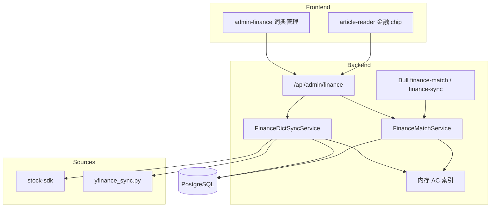

# 金融产品标签功能 — 设计文档

> **项目路径**：`/www/wwwroot/feedgen`  
> **文档版本**：v1.0  
> **更新日期**：2026-10-22  
> **状态**：已实施对照文档

本文档描述 FeedGen 中**系统级金融产品词典**、标题/简介关键词匹配、阅读器产品标签与 Admin 管理能力。

**分步开发请使用**：[`docs/FINANCE_PRODUCT_TAGS_PROMPTS.md`](./FINANCE_PRODUCT_TAGS_PROMPTS.md)。

---

## 1. 目标与边界

### 1.1 目标

| 需求 | 说明 |
|------|------|
| 自动打标 | 标题/简介命中金融产品关键词时，关联系统级产品 |
| 阅读器展示 | 标题下方 chip 行，位于 AI 分类左侧；点击打开可配置 K 线 URL |
| 词典管理 | 名称、代码、别称均可作关键词；Admin CRUD / 启停 |
| 同步 | 初始化、定时、手动；主源 stock-sdk，补源 yfinance |

### 1.2 与现有功能的关系

| 功能 | 关系 |
|------|------|
| **UserTag** | 独立并存；不写入 `user_tags` |
| **NewsCategory / AI 分类** | 独立并存；chip 顺序：`金融产品 → AI 分类 → 用户标签` |
| **Article** | 关联表存结果，**不污染** `articles` 列 |

### 1.3 一期范围

- A 股 / 港股 / 美股股票、主要指数、公募基金 / ETF
- K 线：外部服务，默认 `http://127.0.0.1:8765/?symbol={symbol}&period=1d`

### 1.4 非目标（一期）

- 仓库内嵌 K 线绘图
- 实时行情推送 / 自选股
- LLM 实体识别
- 期货 / 大宗 / 债券（二期）
- 侧栏按产品筛选（二期）

---

## 2. 总体架构

**数据源**

- [stock-sdk](https://github.com/chengzuopeng/stock-sdk)：Node 主源（`codes.cn/hk/us/fund`）
- [yfinance](https://github.com/ranaroussi/yfinance)：Python 补源（全球指数等），`scripts/yfinance_sync.py`

---

## 3. 数据模型

### 3.1 `finance_instruments`

规范产品：`symbol`、`chart_symbol`、`name`、`name_en`、`market`、`asset_type`、`exchange`、`source`、`status`、`priority`、`meta`、`synced_at`。  
唯一：`(market, symbol)`。

### 3.2 `finance_aliases`

关键词：`keyword`、`keyword_norm`、`kind`（name/code/alias/abbr）、`enabled`、`source`（auto/manual）。  
一期：`keyword_norm` **全局唯一**（一词一主产品）。

### 3.3 `article_finance_instruments`

文章 ↔ 产品：`matched_keyword`、`matched_field`、`confidence`、`matched_at`。  
复合主键 `(article_id, instrument_id)`。

### 3.4 `finance_sync_jobs`

同步任务日志：status、mode、source、计数、error、耗时。

### 3.5 `finance_settings`（单行键值或 JSON）

K 线 URL 模板、默认 period、每文最大 chip 数等。可用表 `finance_app_settings`（key/value）实现。

---

## 4. 同步与匹配

### 4.1 chart_symbol 规则

| 市场 | 规则 |
|------|------|
| 沪市 | `sh` + 代码 |
| 深市 | `sz` + 代码 |
| 北交所 | `bj` + 代码 |
| 港股 | `hk` + 5 位 |
| 美股 | ticker 大写 |
| 基金 | 6 位代码（可 Admin 改） |

### 4.2 匹配

- 文本：`title_zh||title` + `description_zh||description`（截断 2k）
- Aho-Corasick；短词保护；每文最多 5 个产品
- 入库 enqueue + Admin backfill；`FINANCE_MATCH_ENABLED`

### 4.3 同步触发

| 触发 | 说明 |
|------|------|
| 初始化 | Admin 一键 / CLI |
| 定时 | `FINANCE_DICT_SYNC_INTERVAL_MS`（默认 24h） |
| 手动 | `POST /api/admin/finance/sync` |

---

## 5. API

前缀：`/api/admin/finance`（需 admin JWT）

| 方法 | 路径 | 说明 |
|------|------|------|
| GET | `/instruments` | 分页搜索 |
| POST | `/instruments` | 手工新增 |
| PATCH | `/instruments/:id` | 更新 / 启停 |
| GET/POST/PATCH/DELETE | `/instruments/:id/aliases` | 别名 CRUD |
| POST | `/sync` | 触发同步 |
| GET | `/sync/jobs` | 同步日志 |
| POST | `/match/backfill` | 重匹配 |
| POST | `/match/reload-index` | 重建内存索引 |
| GET/PUT | `/settings` | K 线模板等 |
| GET | `/overview` | 统计概览 |

文章列表字段：`finance_instruments[]`（含 `kline_url`）。

---

## 6. 前端

### 6.1 阅读器

- `buildFinanceChipsHtml`：`.finance-chip`，市场徽记 + 简称 + 小字代码
- 点击 `window.open(kline_url)`；列表最多 3 + `+N`

### 6.2 Admin

- `#panel-finance` + `admin-finance.js`
- 概览、同步、产品表、别名、设置、同步日志

---

## 7. 环境变量

| 变量 | 默认 | 说明 |
|------|------|------|
| `FINANCE_MATCH_ENABLED` | 开（非 `0`） | 匹配开关 |
| `FINANCE_DICT_SYNC_ENABLED` | 开（非 `0`） | 定时同步 |
| `FINANCE_DICT_SYNC_INTERVAL_MS` | `86400000` | 同步间隔 |
| `FINANCE_KLINE_URL_TEMPLATE` | `http://127.0.0.1:8765/?symbol={symbol}&period={period}` | K 线模板 |
| `FINANCE_KLINE_DEFAULT_PERIOD` | `1d` | 默认周期 |
| `YFINANCE_PYTHON` | `python3` | yfinance 解释器 |

运维见 [SERVICE.md](./SERVICE.md)。

---

## 8. 风险与对策

| 风险 | 对策 |
|------|------|
| 词典过大 | 仅加载 enabled；基金可分期 |
| 短名误匹配 | 短词禁用、一词一主、人工审核 |
| 源限流 | Sync 可重试；不阻塞爬虫 |
| chart_symbol 不一致 | 可配置模板 + Admin 改单条 |
| yfinance 缺失 | 不阻断 stock-sdk 主同步 |
